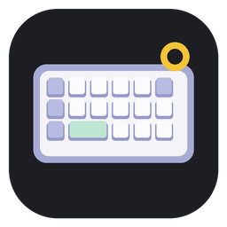
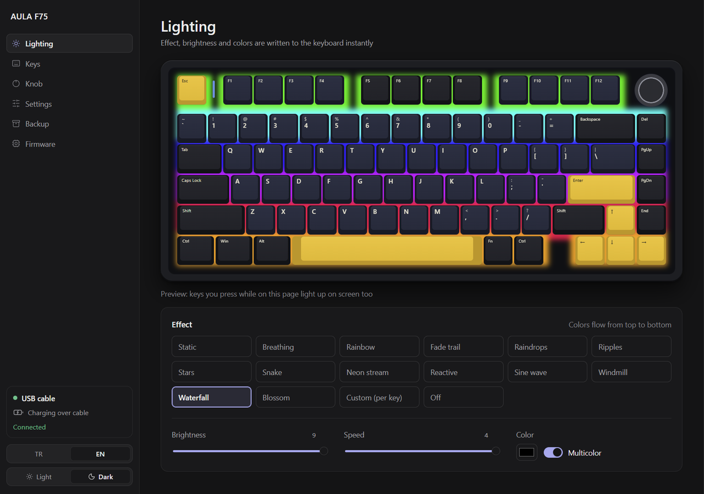
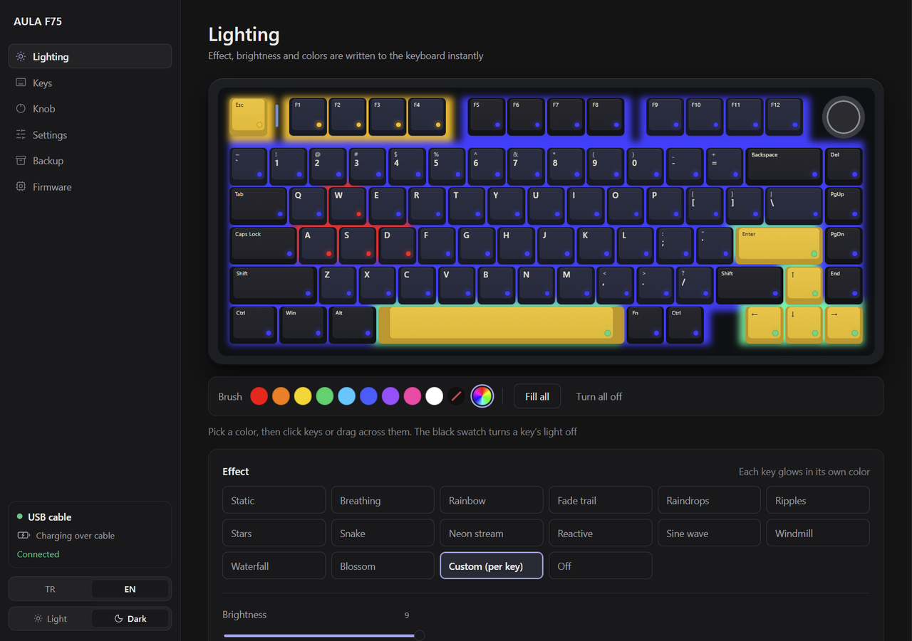
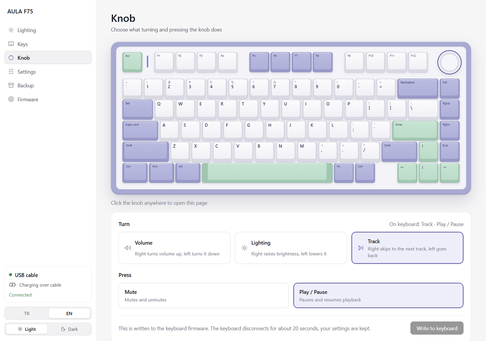
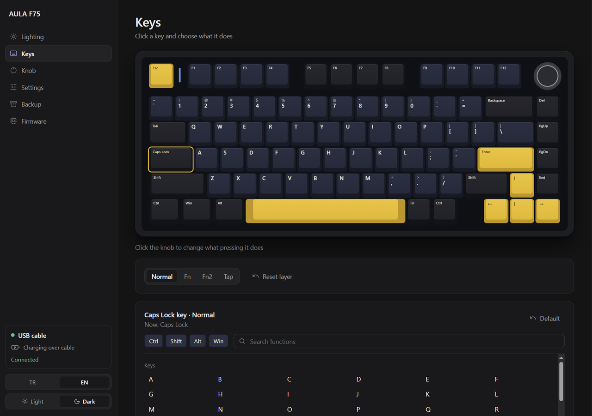
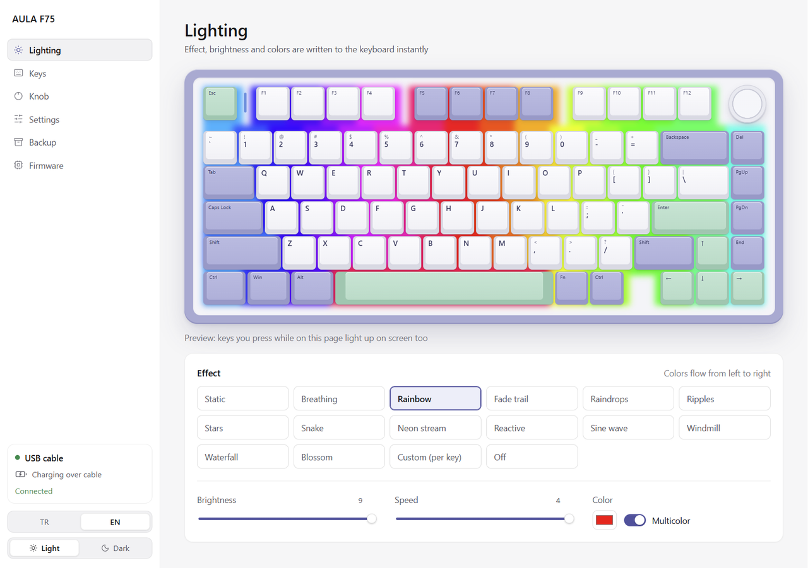
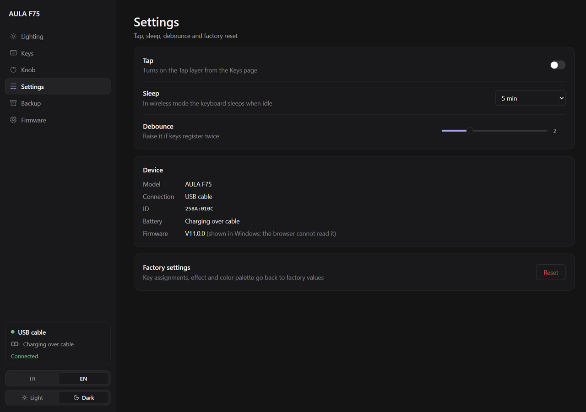
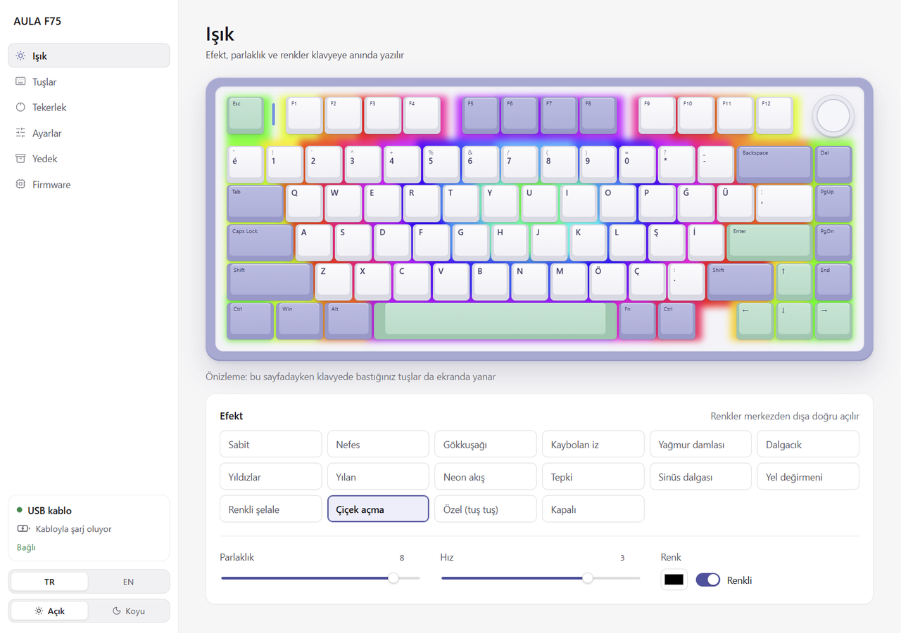

<div align="center">



# AULA F75 Alternative App

**A lightweight, open-source replacement for the AULA F75 driver.**
Lighting, key remapping, knob modes, battery and firmware tools — in one small app that talks to the keyboard directly over WebHID.

[English](#english) · [Türkçe](#türkçe)



</div>

---

## English

The official AULA software is a 2.6 MB Windows program that runs as administrator in the background. This app does the same job from a single window: nothing to install system-wide, nothing running in the background, no data sent anywhere.

### Features

| | |
|---|---|
| **Lighting** | All 15 effects plus Off, brightness, speed, color or multicolor. The on-screen keyboard plays a live preview of the selected effect, and keys you press light up on screen. |
| **Per-key colors** | Paint keys with a brush, ten preset colors or any custom color. Each key shows its LED color as a glow and a small dot. |
| **Key remapping** | Four layers (Normal, Fn, Fn2, Tap). One searchable list for keys, shortcuts with Ctrl/Shift/Alt/Win, media, mouse buttons, lighting controls and lock functions. |
| **Knob** | Choose what turning and pressing the knob does: **volume**, **lighting brightness** or **track skip**, and mute or play/pause. Fn + press can be assigned to anything. Sensitivity: act every 1, 3, 6 or 12 clicks (half a turn), or set it by turning the knob. |
| **Battery** | Live percentage and charging state in 2.4G mode. |
| **Settings** | Tap layer, sleep timer, debounce, factory reset. |
| **Backup** | Save every setting to a file and load it back. |
| **Firmware** | Back up the keyboard firmware and restore it. |
| **Look** | Light and dark themes (the keyboard drawing follows the theme), English and Turkish with matching US / Turkish Q keycap legends. |

<table>
<tr>
<td></td>
<td></td>
</tr>
<tr>
<td></td>
<td></td>
</tr>
<tr>
<td></td>
<td></td>
</tr>
</table>

### Getting started

**Windows:** download [AULA-F75-Setup.exe](https://github.com/mondieuu/aula-f75-alternative/releases/latest/download/AULA-F75-Setup.exe) and run it. It installs for your user only (no administrator rights) and adds a desktop shortcut. The installed app checks this repository's [releases](https://github.com/mondieuu/aula-f75-alternative/releases) for a newer version, downloads it in the background and asks before restarting. You can also check by hand, follow the download and restart from **Settings → App update**. The installer is not code-signed, so Windows SmartScreen may show a warning: choose **More info → Run anyway**.

**From source** (needs [Node.js](https://nodejs.org); tested on Windows, built on Electron so macOS and Linux should work too):

```bash
git clone https://github.com/mondieuu/aula-f75-alternative.git
cd aula-f75-alternative
npm install
npm start
```

The app connects to the keyboard on its own. It only allows AULA devices (`258a`, `3554`, `0603`), never shows a device picker and never leaves its own page.

**In a browser:** open `index.html` in Chrome, Edge or another Chromium-based browser and press **Connect keyboard**. WebHID does not work in Firefox or Safari.

> On Linux you may need a udev rule that gives your user access to `hidraw` devices with vendor IDs `258a` and `3554`.

### Supported connections

| Connection | Lighting, sleep, debounce | Key remapping, per-key colors | Battery | Knob and firmware |
|---|---|---|---|---|
| USB cable | Yes | Yes | Charging only | Yes |
| 2.4G receiver | Yes | If the keyboard allows reading them | Percentage and charging | No (cable required) |

Bluetooth is not supported.

### How the knob modes work

Knob rotation is hard-wired in the keyboard firmware: no key code you assign can change it. The knob page therefore writes a small patch (3 to 23 bytes) to the firmware through the chip’s own bootloader:

- **Volume** is the factory behavior.
- **Track** changes the consumer codes the knob sends to next / previous track.
- **Sensitivity** adds a small click counter in free flash space (0xEFC4): the knob acts once every N clicks and the count restarts when you change direction. **Set by turning** writes a temporary measuring mode where each click sends a reserved code Windows ignores, so the app can count clicks while music and volume stay untouched, then writes the measured number.
- **Lighting** makes the knob call the same brightness routine that Fn + ↑ / ↓ uses.

It is one click: the app switches the keyboard to its bootloader, reads and backs up the current firmware, writes and verifies the patch, then restarts the keyboard and reconnects (about 10 seconds), showing each step as it goes. The patch is only offered when the firmware is recognized (AULA F75 V11). The written data is read back and compared before the keyboard is allowed to start it. If anything does not match, the keyboard stays in bootloader mode and you can write the original firmware back from the Firmware page. The bootloader itself is never written.

> **Use the firmware features at your own risk.** Back up your firmware first (Firmware → Download firmware) and keep the USB cable plugged in while writing.

### Privacy and resources

- No analytics, no accounts. The only network request is the update check against GitHub Releases: automatic in the installed Windows app, only when you press **Check for updates** when running from source, and never in a browser.
- Plain HTML, CSS and JavaScript. No framework and no build step.
- The effect preview is one canvas capped at 30 fps and stops when the page is hidden or the effect is static.

### How it was made

The protocol was worked out from the official software’s USB traffic and from reading its code. Every setting was verified by writing it to a real F75 and reading it back. The full notes (in Turkish) are in [docs/PROTOCOL.md](docs/PROTOCOL.md).

### Credits

- Bootloader protocol: [sinowealth-kb-tool](https://github.com/carlossless/sinowealth-kb-tool) by Karolis Stasaitis (MIT)
- Design approach: [unslop](https://github.com/heydamir/unslop) by Damir Sokolovsky ([@heydamir](https://x.com/heydamir)), CC BY 4.0
- Icons: paths from [Lucide](https://lucide.dev) (ISC)

### Disclaimer

This project is not affiliated with, endorsed by or supported by AULA. “AULA” and “F75” are used only to describe the keyboard this app works with. The software is provided as is, without warranty of any kind.

### License

[MIT](LICENSE)

---

## Türkçe

AULA’nın resmi yazılımı, arka planda yönetici olarak çalışan 2.6 MB’lık bir Windows programı. Bu uygulama aynı işi tek bir pencereden yapıyor: sisteme kurulacak bir şey yok, arka planda çalışan bir şey yok, hiçbir yere veri gitmiyor (kurulu Windows uygulaması yalnızca güncelleme için GitHub’a bakar).

### Özellikler

- **Işık:** 15 efekt ve kapalı, parlaklık, hız, renk ya da renkli mod. Ekrandaki klavye seçili efekti canlı oynatıyor; bastığın tuşlar ekranda da yanıyor.
- **Tuş tuş renk:** Fırça, on hazır renk ya da istediğin renk.
- **Tuş atama:** Dört katman (Normal, Fn, Fn2, Tap) ve tek bir aranabilir işlev listesi.
- **Tekerlek:** Çevirme **ses**, **ışık parlaklığı** ya da **şarkı atlama**; basma sessiz ya da oynat/duraklat. Fn + basma istediğin işleve atanabiliyor. Tek tıkla yedek alınır, yazılır, doğrulanır ve klavye yeniden başlar (yaklaşık 10 saniye); her adım ekranda görünür. Hassasiyet: her tıkta, 3, 6 ya da 12 tıkta bir (yarım tur); ya da tekerleği çevirerek ölçüp ayarlayabilirsin.
- **Pil:** 2.4G modunda canlı yüzde ve şarj durumu.
- **Ayarlar, yedek, firmware:** Tap, uyku, debounce, fabrika ayarları; ayar dosyası; firmware yedekleme ve geri yükleme.
- **Görünüm:** Açık ve koyu tema; Türkçe ve İngilizce, Türkçe Q ve ABD tuş başlıklarıyla.

### Başlatma

**Windows:** [AULA-F75-Setup.exe](https://github.com/mondieuu/aula-f75-alternative/releases/latest/download/AULA-F75-Setup.exe) dosyasını indirip çalıştırın. Yönetici izni istemeden kurulur ve masaüstüne kısayol ekler. Kurulu uygulama yeni sürümleri bu deponun [release sayfasından](https://github.com/mondieuu/aula-f75-alternative/releases) kendisi denetler, arka planda indirir ve yeniden başlatmadan önce sorar. **Ayarlar → Uygulama güncellemesi** bölümünden elle denetleyip indirmeyi izleyebilir ve yeniden başlatabilirsiniz. Kurulum dosyası imzalı olmadığı için Windows SmartScreen uyarı gösterebilir: **Ek bilgi → Yine de çalıştır**.

Yeni sürüm yayınlamak için `package.json` içindeki `version` değerini artırıp `main` dalına göndermek yeterli; GitHub Actions kurulum dosyasını derleyip release olarak yayınlar.

**Kaynaktan:**

```bash
git clone https://github.com/mondieuu/aula-f75-alternative.git
cd aula-f75-alternative
npm install
npm start
```

Tarayıcıda kullanmak için `index.html` dosyasını Chrome, Edge ya da Chromium tabanlı bir tarayıcıda açıp **Klavyeyi bağla**’ya basın.

> **Firmware özelliklerini kendi sorumluluğunuzda kullanın.** Önce firmware yedeğinizi alın (Firmware → Firmware’i indir) ve yazma sırasında kabloyu çıkarmayın. Yazılan veri doğrulanmadan klavye yeni firmware ile açılmaz; bir sorun olursa orijinal yedek aynı sayfadan geri yazılabilir.

Bu proje AULA ile bağlantılı değildir. Protokol notları: [docs/PROTOCOL.md](docs/PROTOCOL.md).
